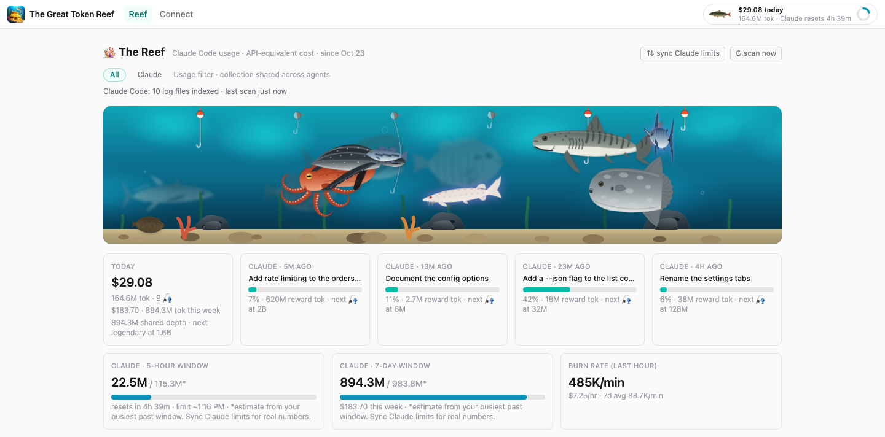

# The Great Token Reef

The Great Token Reef is a local, Mac-only aquarium game built from your Claude
Code and Codex token usage. It reads the session logs already on your machine,
turns your usage into stats, and awards fish as you cross token milestones. It
runs entirely on your own computer: nothing is uploaded anywhere.



The screenshot uses made-up data from `pnpm demo`, described below.

## Quick start

```sh
nvm install 24
corepack enable
pnpm install
pnpm start
```

`pnpm start` builds the web app, starts the server on `127.0.0.1:3033`, and
opens the Reef in your browser.

## Commands

- `pnpm dev` runs the server and the web app in development mode.
- `pnpm start` builds the web app and serves everything from one process.
- `pnpm demo` starts the Reef on made-up data (see below).
- `pnpm test` runs every package's tests.
- `pnpm typecheck` typechecks every package.
- `pnpm icons` regenerates the favicon and app icons from `icon.png`.

## Requirements

Node 24 or newer (`nvm install 24`; `.nvmrc` pins it) and pnpm 11.

## Where your data lives

Everything is stored in `~/.great-token-reef/`: one SQLite database with your
usage history, catches and settings. Delete the folder to start over.

Fish are forward-only: history already on your disk when you first install
shows up in your stats, but only usage after install earns fish.

## Try it with demo data

```sh
pnpm demo
```

This writes a made-up Claude Code history to a temporary folder and starts the
Reef on `127.0.0.1:3034` (change it with `GTR_PORT`). It sets all three data
locations, so your own session logs and `~/.great-token-reef/` are never read
or changed. The tank starts empty with a yellow badge showing the catches
waiting to be released; click it to fill the tank. Stop the demo (Ctrl-C)
before running it again.

## Optional connections

Open the Connect page to add any of these. The Reef works without them.

- **Claude plan limits** adds your real 5-hour and 7-day limits to the water
  and current. It uses an unofficial Anthropic endpoint, so it may stop working
  without notice.
- **GitHub** and **Jira** bring visitors to the tank when your work moves.

## Changing the icon

Replace `icon.png` in the repo root, then run `pnpm icons`.

## Environment overrides

- `GTR_PORT` changes the port (default `3033`).
- `GTR_DATA_DIR` changes the data folder (default `~/.great-token-reef`).
- `GTR_CC_PROJECTS_DIR` changes where Claude Code logs are read from.
- `GTR_CODEX_SESSIONS_DIR` changes where Codex logs are read from. Without it,
  the Reef reads `sessions` inside `$CODEX_HOME` if set, otherwise `~/.codex`.
- `GTR_NO_OPEN=1` stops the browser from opening on start.
