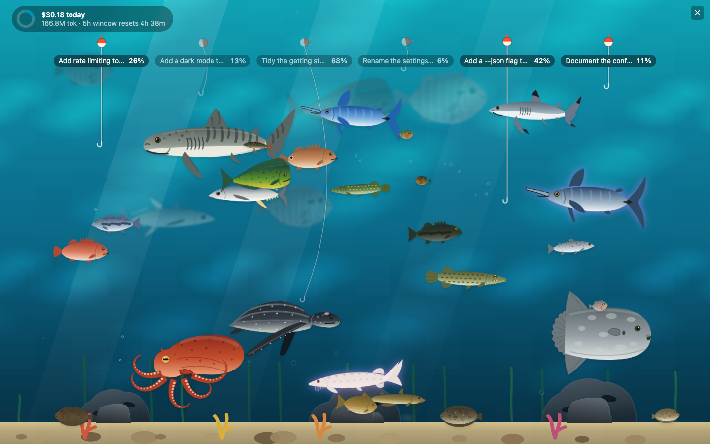
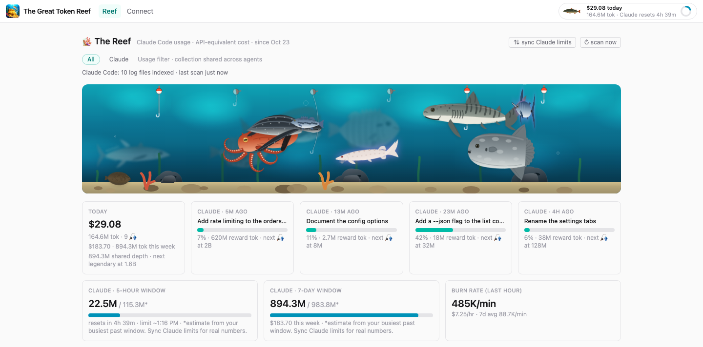

# The Great Token Reef

The Great Token Reef is a local, Mac-only aquarium game built from your Claude
Code and Codex token usage. It reads the session logs already on your machine,
turns your usage into stats, and awards fish as you cross token milestones. It
runs entirely on your own computer: nothing is uploaded anywhere.





The screenshots use made-up data from `pnpm demo`, described below.

## Quick start

```sh
nvm install 24
corepack enable
pnpm install
pnpm start
```

`pnpm start` builds the web app, starts the server on `127.0.0.1:3033`, and
opens the Reef in your browser.

## Commands

- `pnpm dev` runs the server and the web app in development mode.
- `pnpm start` builds the web app and serves everything from one process.
- `pnpm demo` starts the Reef on made-up data (see below).
- `pnpm test` runs every package's tests.
- `pnpm typecheck` typechecks every package.
- `pnpm icons` regenerates the favicon and app icons from `icon.png`.

## Requirements

Node 24 or newer (`nvm install 24`; `.nvmrc` pins it) and pnpm 11.

## Where your data lives

Everything is stored in `~/.great-token-reef/`: one SQLite database with your
usage history, catches and settings. Delete the folder to start over.

Fish are forward-only: history already on your disk when you first install
shows up in your stats, but only usage after install earns fish.

## Try it with demo data

```sh
pnpm demo
```

This writes a made-up Claude Code history to a temporary folder and starts the
Reef on `127.0.0.1:3034` (change it with `GTR_PORT`). It sets all three data
locations, so your own session logs and `~/.great-token-reef/` are never read
or changed. The tank starts empty with a yellow badge showing the catches
waiting to be released; click it to fill the tank. Stop the demo (Ctrl-C)
before running it again.

## Optional connections

Open the Connect page to add any of these. The Reef works without them.

- **Claude plan limits** adds your real 5-hour and 7-day limits to the water
  and current. It uses an unofficial Anthropic endpoint, so it may stop working
  without notice.
- **GitHub** and **Jira** bring visitors to the tank when your work moves.

## Changing the icon

Replace `icon.png` in the repo root, then run `pnpm icons`.

## Environment overrides

- `GTR_PORT` changes the port (default `3033`).
- `GTR_DATA_DIR` changes the data folder (default `~/.great-token-reef`).
- `GTR_CC_PROJECTS_DIR` changes where Claude Code logs are read from.
- `GTR_CODEX_SESSIONS_DIR` changes where Codex logs are read from. Without it,
  the Reef reads `sessions` inside `$CODEX_HOME` if set, otherwise `~/.codex`.
- `GTR_NO_OPEN=1` stops the browser from opening on start.

## Releases

Newest first.

### Expeditions, November 11, 2026

By [@yglgary](https://github.com/yglgary).
Pull request: <https://github.com/echoreef/great-token-reef/pull/13>

A new Expeditions tab sends a party of three fish on a trip into the deep:
the shallows, the reef, the drop-off or the abyss. A trip moves forward as you
use tokens, and a deeper trip lasts longer, from a quarter of your typical day
up to five days. When the party comes home, its fish gain experience and levels
and may bring back one of 32 finds to collect. Fish earn titles as they level
up, and you pick which one each fish shows. A stronger party is needed for the
deeper water; a party below the recommended strength earns less and finds
nothing, but a trip never fails. In the fullscreen tank, the party swims off
when a trip starts and drops back in when it ends. A minimap shows how far the
trip has gone, and you can plan the next trip without leaving the tank.

### Wary fish, November 6, 2026

By [@yglgary](https://github.com/yglgary).
Pull request: <https://github.com/echoreef/great-token-reef/pull/7>

In the fullscreen tank, a fish small enough for a shark or the killer whale to
eat now tends to turn and dart off rather than swim straight at one. The closer
the shark, the likelier the turn, but it is only a habit: now and then a fish
swims right past. A fish that bumps into a shark from any side often darts
away too. A fish already being chased, eating, resting at home or held under
the pointer pays no attention.

### Shark hunt, November 4, 2026

By [@yglgary](https://github.com/yglgary).
Pull request: <https://github.com/echoreef/great-token-reef/pull/6>

In the fullscreen tank, sharks and the killer whale now and then hunt a fish no
more than half their size. Most hunts end in a bite: the fish shrinks into the
shark's mouth in a puff of flecks and bubbles. About one in three ends with the
fish darting away. An eaten fish drops back in from the surface 30 seconds
later, and your collection never changes. The whale shark and megamouth eat
plankton, so they leave other fish alone.

### Light and dark mode, October 28, 2026

By [@austinbrownapfm](https://github.com/austinbrownapfm).
Pull request: <https://github.com/echoreef/great-token-reef/pull/4>

A button in the header switches between light and dark mode and remembers your
choice. With no choice saved, the Reef follows your system setting.
